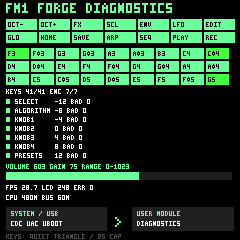

# FM1 Forge starter and diagnostic firmware

This asset-free independent firmware is the basic hardware diagnostic and module
starter for **FM1 FW Factory / FM1 Forge**. It is not M-VAVE's stock firmware.
Build/package checks, write/readback checks, running telemetry and physical
acceptance are separate evidence levels. No hardware acceptance is implied here.



This is rendered by the actual firmware renderer at240×240 using illustrative
input/counter values. It is an offline preview, not a device photograph or an FPS
measurement. `tests/preview.c` reproducibly emits the native RGB565 render.

The LCD shows all41 live buttons/keys, latched seen coverage, seven encoder edge
counts and invalid-transition counts, PB6 raw volume/min/max/gain, measured LCD
FPS/completion/errors, current CPU/bus reports and a SYSTEM/USB → USER MODULE
graph. Seen indicates observed software input, not electrically tested hardware.
Pressing a piano key starts an original quiet triangle tone; panel buttons only
light their indicators. Highest held piano slot wins. A key tone has10ms attack
and release and a2-second sustain cap; continued holding does not retrigger.
Silence is the startup default. The ADC master volume scales all speaker output.
Scanner faults allow at most three retries spaced50ms; contacts are re-primed,
encoder counts/seen/error history are retained. A scanner fault releases held
keys immediately; missing complete scans release100ms after the last good scan.
Exhausted recovery leaves USB/LCD available with its fault and error evidence.

## Fixed HAL and user module boundary

`forge.h` is ABI1. `fm1_forge_input` exposes41 pressed/seen bits, all seven signed
encoder counts/invalid counts, raw/accepted-gain volume and scanner/error counters.
`fm1_forge_hal_snapshot()` returns an immutable published copy. The module gets
the same copy in `update()`. No hardware handles or raw device writes are exposed.

The fixed runtime owns:

- USB CDC, optional stereo UAC1, serial-to-UBOOT confirmation and recovery.
- SPI2 paced1ms coherent scanner snapshots and separate PB6 ADC sampling2ms.
- SPI1 aligned LCD DMA storage, completion barriers and immutable active/pending
  frames. The display HAL copies submitted strips; source pointers are not kept.
- ALINK0/I2S stereo44.1kHz signed24-in32 DAC and final master gain/startup ramp.
- Conservative clock profile selection before USB or DMA starts.

`fm1_forge_module` supplies `init`, `update`, `render`, `audio` and `shutdown`.
Update/render execute on one peripheral task. Render receives an immutable frame
and an8-row output strip in RGB565 big-endian or RGB444 packed format. It must
fill the entire strip and retain no pointers. Audio receives exactly64 interleaved
stereo frames in signed24-in32 format, under the DAC IRQ; never wait, allocate,
log, call GPIO/USB/flash, change clocks or take task locks there. Mutable values
shared between module update and audio require bounded atomic publication; the
starter shares none. Heavy sequencing/synthesis belongs in task update with
bounded precomputed audio. Firmware modules are trusted native C, not sandboxed.
User audio is clamped to signed24 range before UAC capture/mix and master gain;
the supplied starter emits silence. Numeric bounds do not establish sonic safety.

Default `module=diagnostics` supplies the diagnostic screen/key tones. The supplied
user starter is silent and renders the input/health dashboard; select `module=user`
to link the project's `user.c`. It has no private game/music assets.

## Create and build a project

```powershell
python firmware/forge/create_project.py --base projects --slug first-synth --name "First Synth"
python firmware/forge/build_project.py --project projects/first-synth
```

Creation refuses existing directories, traversal, reserved Windows names and
invalid slugs. It creates `forge.json`, `user.c` and `README.md` only. Build loads
and validates the versioned config and actually invokes the target builder with
the selected clock/LCD/UAC/user-module source. It creates a fresh timestamped
output directory; no device is opened, reset or flashed. `--dry-run` prints exact
builder arguments without execution. Direct diagnostic build:

```powershell
python firmware/usb-diag/build.py --controller 0 --factory-diag --out firmware/usb-diag/build/my-forge-candidate
```

`config.schema.json` / `config.py` define schemaVersion1. Required config:

```json
{"schemaVersion":1,"project":{"slug":"first-synth","displayName":"First Synth"},"profile":"forge-diag","clockPreset":"sdk-default","lcdPreset":"stock-dma","module":"diagnostics","usb":{"cdc":true,"uac":true,"uboot":true}}
```

USB CDC and UBOOT are fixed. `uac=false` compiles a CDC-only profile; true provides
48kHz stereo PCM16 UAC playback and synthesized line capture through EP1, with
bounded resampling to the44.1kHz DAC. Capture is generated digital audio, not a
claimed analog microphone input. Opening/changing DTR on CDC does not stop the
persistent diagnostics. `FORGE STOP` is an explicit full shutdown before UBOOT.

## LCD and clock presets

`stock-dma` defaults to maintained async RGB565 with stock initialization/divider.
`spi15-rgb444` and `spi30-rgb444` retain stock startup then switch idle SPI1 to
15/30MHz nominal packed12bpp only if the reported LSB clock is exactly60MHz. They
do not change PLL/CPU/bus clocks to obtain a requested rate. Busy/error counters
and measured FPS report actual results; a preset name is not a measured frame rate.
Display building is bounded to128 rows per task turn, then yields, independent
of scanner/audio cadence. Completion ownership and DMA coherence are reused from
the maintained LCD driver, including its pending-frame handoff correction.

`sdk-default` preserves boot clocks without writes and reports their actual values.
`sdk-320` is experimental opt-in and invokes the pinned SDK application API
`system_clock_set(320000000)` ONCE before
USB/DAC start, checks exact320MHz report and HSB<=160MHz / SFC,LSB<=80MHz. It is
not described as faster than the default; stock/SDK boot may report480MHz.
Changing CPU clocks during DMA or through serial/user callbacks is blocked.
The SDK320 table selects a53MHz LSB clock, so project validation rejects
`sdk-320` combined with either fast LCD preset; select `stock-dma` for SDK320.
No396/480MHz overclock option is offered: the pinned SDK's396MHz overclock table
requests198/98/98MHz HSB/SFC/LSB and contradicts its own conservative bus bounds.
The fast LCD guard can reject a CPU preset that changes the bus away from60MHz.
Bench USB/audio/LCD/input timing acceptance is required for every nondefault preset.

Clock source: pinned `include_lib/driver/cpu/wl82/asm/clock.h` supplies320M and
declares system setters24–396M; `apps/common/system/system_vdd_clock.c` defines
the conservative bus bounds and explicitly gated396M overclock table. The
shared `clock_contract.h`480M bound validates reports; it is not a setter license.

## Physical input and pin contract

Panel slots0–13: OCT−, OCT+, FX, SCL, ENV, LFO, EDIT, GLO, HOME, SAVE, ARP, SEQ,
PLAY/STOP, REC. Piano slots14–40 run nominal MIDI53–79, F3–G5. Column inputs are
PA0/5/6/7/8 and PB7; SPI2 uses PA3/4 and PA1 latch. Stock encoder contacts:

| ID | Label | A/B matrix cells |
|---:|---|---|
| 0 | SELECT | 10/20 |
| 1 | ALGORITHM | 30/40 |
| 2 | KNOB1 | 91/a1 |
| 3 | KNOB2 | 90/a0 |
| 4 | KNOB3 | 70/80 |
| 5 | KNOB4 | 50/60 |
| 6 | PRESETS | 15/25 |

Counts are contact edges; clockwise polarity and push functions are not invented.
Volume is PB6 / ADC4; its0–1023 raw range maps to0–127 master gain. LCD uses SPI1
PC7CS/PC8DC/PC9SCLK/PC10MOSI. I2S uses PC0MCLK/PC1LRCLK/PC2BCLK/PC6channel3 data.
The source only establishes PA2 driven low at stock startup; its electrical role
as reset/backlight/OE remains unassigned. PC6 is not an amplifier mute GPIO.

## Serial controls and acceptance

`FORGE STATUS`, `INPUT`, `AUDIO`, `LCD`, `CLOCK`, `MODULE`, `HELP`; `HAL GET`
aliases full input reporting. Send LF-only framing. `FORGE STOP` requests full
scanner/audio/LCD/UAC shutdown; poll `FORGE STATUS` until running0/pending0.
The existing `UBOOT` then `UBOOT CONFIRM` five-second confirmation performs serial
entry to the existing Jieli downloader. Actual flash writes remain the protected
external UBOOT writer; CDC `COMMIT` stays blocked. USB Audio Class is not a writer.

Host validation:

```powershell
cmake -S firmware/forge -B firmware/forge/build/host
cmake --build firmware/forge/build/host --config Release
ctest --test-dir firmware/forge/build/host -C Release --output-on-failure
python firmware/forge/tests/test_projects.py
```

Tests cover all41 debounce/release/seen transitions, chords, stale-input release,
clock wrap,7encoder/volume state, every piano tone's bounds/cap/release, full-frame
RGB565→RGB444 consistency and output canaries, safe creation and real config-to-
builder translation. Target build/static audits must pass before staging transfer.
Actual `target.c` mock suites additionally exercise default/no-clock-write,
sdk320 exact-readback rejection, retained CDC diagnostics on DTR changes,
IIS→ADC→ALINK→LCD order, custom-module callbacks/output clipping, CDC-only
and composite profiles, scanner-error recovery with retained coverage,
clock calls blocked during DMA, full STOP teardown and reported quiescence.
After exact write/full readback/one reset, verify CDC identity, advancing counters,
zero faults and UAC enumeration. Physical LCD/41controls/7encoders/volume sweep,
audible tones, playback/capture quality and long-run timing remain bench checks.
