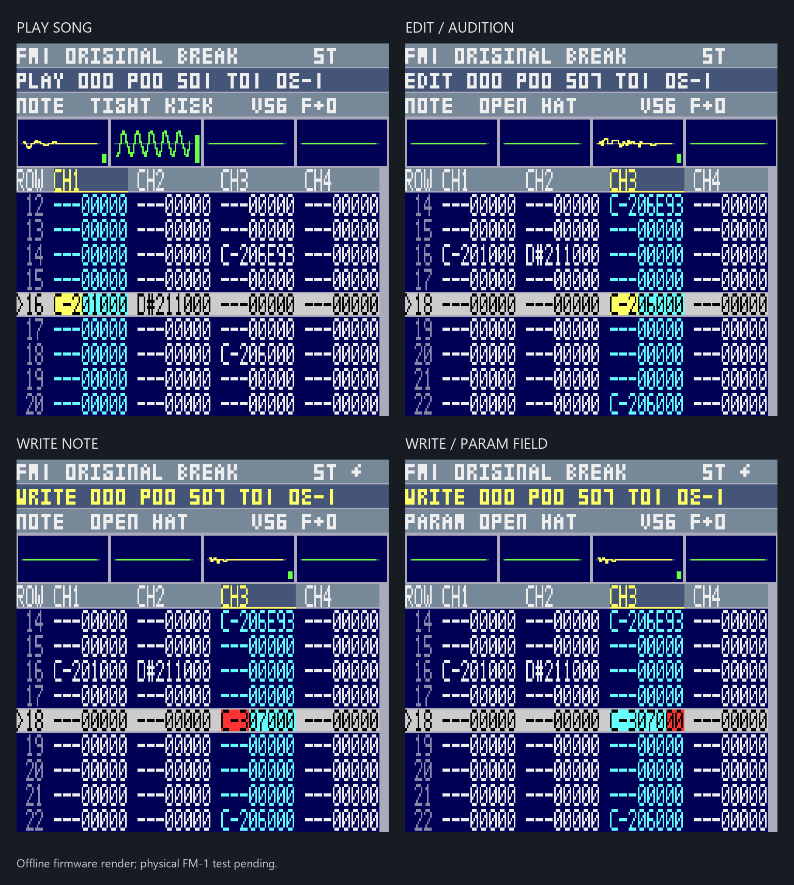
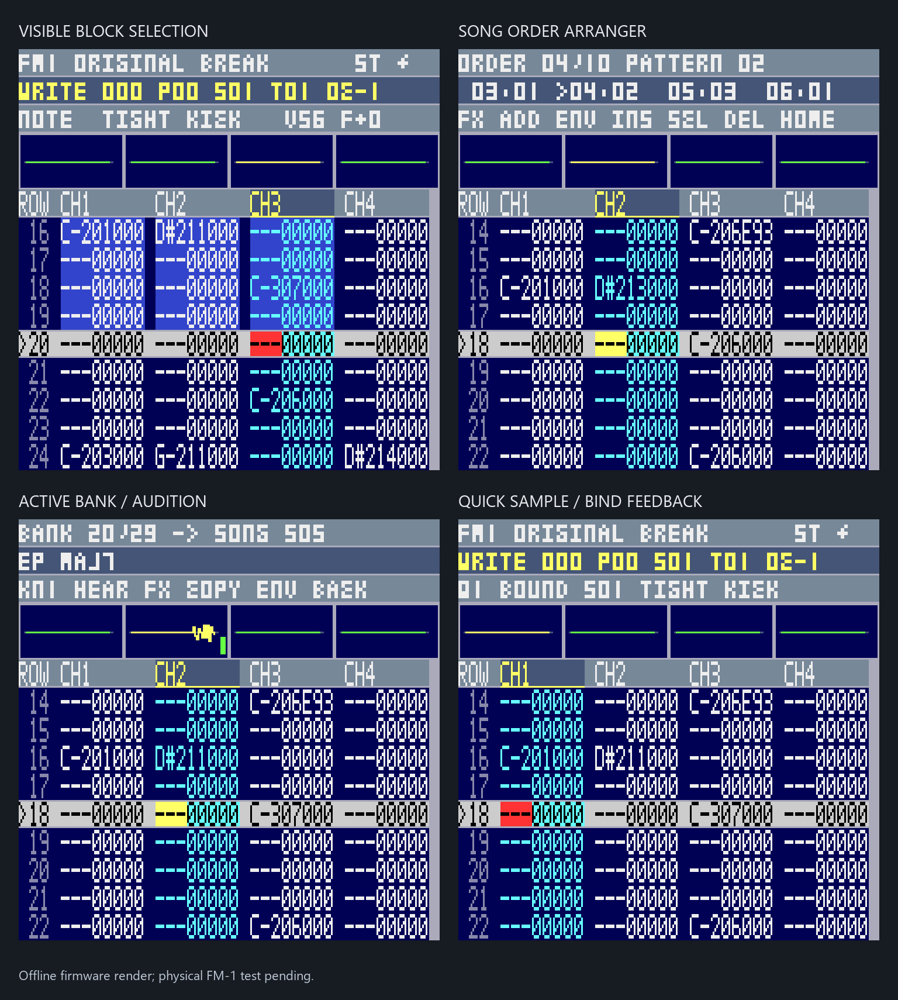

# Milestone #2 implementation and acceptance

Date: 2026-10-05 JST. Scope: [Issue #2](https://github.com/Keitark/fm1-tracker/issues/2)
and [IMPLEMENTATION_PLAN.md](IMPLEMENTATION_PLAN.md). Base: installed v30 source,
with its encoder snapshot/backlog correction retained.

## Delivered source

| Plan phase | Implementation |
| --- | --- |
| 1 | NOTE/SMP/FX/PARAM, semitone transpose, independent nibble editing/clear, full clear, practical steps |
| 2 | Read/set/append/insert/delete/duplicate orders; separate blank/duplicate patterns |
| 3 | Visible row/channel rectangle, fixed 1024-byte clipboard, clipped overwrite paste |
| 4 | Eight current-MOD sample shortcuts with captured-sample 600 ms bind gesture |
| 5 | Nine rows, fixed center, four scopes, field/block highlights, notices and compact contexts |
| 6 | Direct encoder mapping, stopped-only edits, selected-order song / selected-pattern loop, STOP row sync |
| 7 | Independently validated FMB parser, immutable audition, explicit sample import and PC CRUD tooling |
| 8 | Procedural original 29-sample bank, 81,808 bytes, asset-only CC0 dedication |
| 9 | Original 160 BPM four-channel tutorial, six patterns / ten orders, 87,612 bytes |
| 10 | NEW SONG clears sequence and sample payload; importing a bank sound is explicit |

The complete control table and gestures are in [README.md](README.md).
Bank provenance, format and PC commands are in [samples/ACTIVE_BANK.md](samples/ACTIVE_BANK.md).
The demo arrangement is INTRO / BREAK A / BREAK A / FILL / BREAK B / BREAK A /
DROP / DROP / FILL / OUTRO, with `09xx`, `E9x`, `Axx`, `Dxx` and `Fxx` examples.

These use the portable firmware renderer with RGB444 truncation. They are not
device photographs. `preview/preview-manifest.json` records source/content/frame
hashes. Frame rate and input/audio timing cannot be established from these renders.

## Format and memory decisions

- Ordinary MOD sample materialization checks lengths, aliases, loop metadata
  and total capacity before changing any bytes. Replacing a sample shifts only
  following payload, preserves patterns and other samples, and marks changes dirty.
- MOD stores no explicit pattern count. Its 128 order bytes determine the stored
  extent. Creating an unreferenced pattern retains the highest pattern in an
  unused order byte; exported songs remain ordinary MODs. At 128 active orders,
  an operation that would lose this extent is rejected transactionally.
  The all-128 scan is also used by
  [OpenMPT's MOD loader](https://github.com/OpenMPT/openmpt/blob/master/soundlib/MODTools.cpp#L362).
- Four-voice/effect playback and stereo routing are retained. One bounded loop
  correction makes valid nonterminal loops repeat the declared region. It follows
  the locally inspected ProTracker 3.15 `PT315.S` sample-trigger logic: nonzero
  loop start truncates the initial pass at loop end; zero-start loops play the
  full initial sample, then the loop. Tests cover song, MOD preview and raw PCM.
- Clipboard uses 1024 fixed bytes. Bank entries are views into embedded ROM/XIP
  PCM; audition does not consume song storage or alter dirty state.
- PCM ring decreases from 2048 to 1536 stereo frames to retain the 128 KiB heap
  gate. Startup/LCD watermark remains 1470 frames; render blocks remain 128 frames.
  Independent physical slots wrap at 1536, while logical unsigned counters retain
  correct subtraction through `uint32_t` overflow. A producer/DAC regression
  covers this boundary. LCD remains asynchronous, SPI 30 MHz, RGB444, one wire
  frame and three-row strips. Actual underruns require a bench test.
- USB load resets cursor/gestures/context and stops stale previews. Structural
  arranger edits clear block selection while retaining clipboard contents.

## Host verification

Commands are reproduced in [README.md](README.md). The tests cover behavior,
including rejected operations leaving bytes unchanged.

- CTest: **6/6 passed**, assertions enabled (editor/player/USB; legacy starter; controls/queue/gestures;
  rendered field/block view; bank parser/import; demo parse/render).
- Python unittest: **13/13 passed** (bank format/capacity/CRC, PC CRUD/WAV, deterministic
  assets, demo arrangement/effects; existing USB client and file server tests).
- Existing `peripheral_logic` encoder regression: **1/1 passed**.
- Whole tutorial rendered through the C player: 2,550,909 frames, 57.844 seconds,
  peak 10,360; both stereo outputs active; arrangement completed.

## Device candidate

Build: `firmware/usb-diag/build/mod-fast-editor-bank-v31` (local ignored output).
WL82 compile/link and static audit passed. Application: **340,912 bytes**,
SHA-256 `ee5df51f85595ddb4c53c357ad8dbd994d25a57b9595b1daef4adb27e9284db9`.
Heap: **131,948 bytes**, 876 bytes above the unchanged 131,072-byte minimum.

The exact boot trace audit gained one reviewed MOD layout encoding:
`ota_status 0x1c5be50 +380 = fm1_boot_trace 0x1c5bfcc`, store at `0x200276c`
is `d1 ec 0f 17`. The 46-byte startup wrapper and 22-byte marker checks remain
strict; symbol/address substitution and verified call targets are still checked.

Package: **1,048,576 bytes**, SHA-256
`8ffb01107fca32f5eb6c395be61cf0e86a623f4e3ceb955d15bedf8692583f63`.
Nine checks passed: application round trip, directory/area/application/config
CRCs, identical boot/config, identical reserved bytes, preserved offsets and
unused application tail. Manifest remains `flashable: false`; packaging performs no device I/O.
The private output is under `private-backups/usb-diag-candidates/<image-sha>/`.

Renderer SHA-256:
`7ec3ba72dfa4b828e55439a33f51d3c58600077de3a7ad6c68f535e639c67d2e`.
MOD SHA-256:
`b7a4a0d04762e895e732c5a78a1f8fc0f40fe96054cad78291db0c96253bae9a`.
Bank SHA-256:
`0696b3a3e75732abf27edbfdd3eb68f9fe689d0cbe13a14c556e853b9abf89f8`.

The demo and bank are embedded read-only; sample import copies only a chosen
entry into the editable MOD. `install-image` produces a PC representation only.

## Physical acceptance remains pending

v31 was deliberately installed on 2026-10-05 JST at the user's request.
[Deployment evidence](../../docs/MOD_FAST_EDITOR_BANK_V31_DEPLOYMENT.md) records
96-sector/full-image verification, CDC boot and 20-second playback telemetry
with zero underruns/errors and approximately 25 UI counter updates/second.
Run the remaining items of the plan's twelve-point physical checklist:
one-detent channel/row movement, obvious field selection, fast KNOB3/4 editing,
PRESETS/shortcuts, piano/WRITE, center-row song/pattern behavior, heard STOP
position, block/arranger workflow, speaker/stereo outputs and scanner/underrun
counters. Also verify a saved edited MOD reopens and plays on the PC.

Writable flash/journal/autosave, power-loss recovery, waveform editing,
on-device WAV resampling and realtime/quantized recording remain follow-up work.
