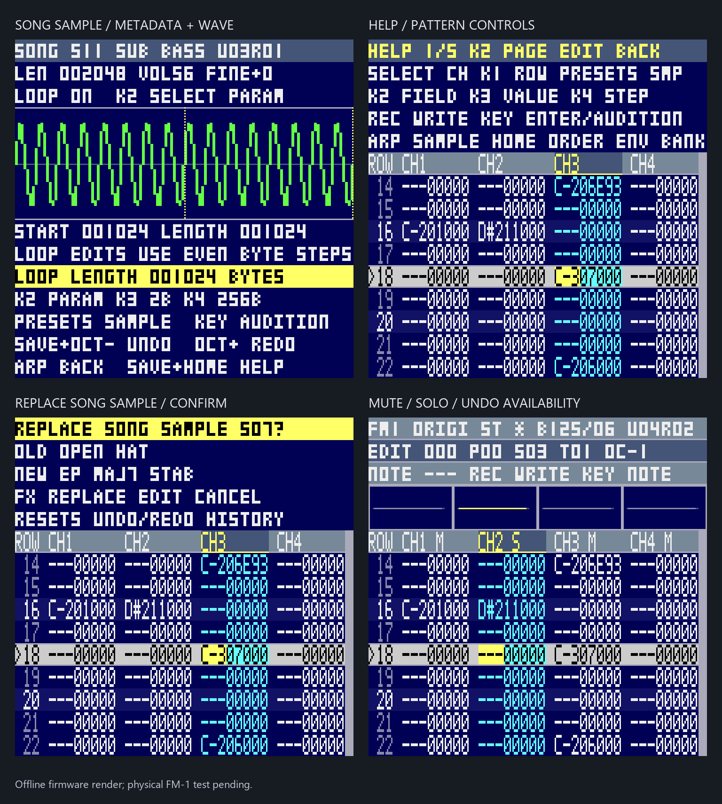

# FM-1 four-channel MOD tracker

An independent ProTracker-style editor for the M-VAVE FM-1, using its 240×240
LCD, piano keys, seven encoders, stereo DAC and USB CDC file exchange.
It edits ordinary self-contained 31-sample, four-channel `M.K.` / `M!K!` MODs
in a 256 KiB RAM song buffer. The ProTracker 3.15 comparison is recorded in
[PROTRACKER315_WORKFLOW.md](PROTRACKER315_WORKFLOW.md).

## Status — 2026-10-29

[Issue #20](https://github.com/Keitark/fm1-tracker/issues/20) extends the
[Milestone #2](MILESTONE_2.md) editor with eight-level undo/redo, sample metadata
editing, block cut/fill/transpose, row operations, mute/solo, confirmations,
contextual help, PC save requests and an interactive graphical workshop.
[WORKFLOW_20.md](WORKFLOW_20.md) is the operating guide and first-song tutorial.

The portable controller, renderer and host regression scenarios are implemented
and tested. The Workflow #20 candidate has not been flashed or physically
accepted. Host checks do not establish current device installation, physical
knob feel, LCD frame rate, DAC output or optional USB audio/video acceptance.
Target build/package results and deliberate hardware validation are recorded
in the [Workflow 20 build record](../../docs/TRACKER_WORKFLOW20_20261029.md).
Older [v32](../../docs/MOD_STOA_DEFAULT_V32_DEPLOYMENT.md),
[v31](../../docs/MOD_FAST_EDITOR_BANK_V31_DEPLOYMENT.md) and
[v30](../../docs/MOD_VIEW_KNOBS_V30_DEPLOYMENT.md) reports are historical evidence.

## Pattern workflow

All four tracks, four scopes and nine pattern rows stay visible. The active row
is fixed at the center; rows move upwards during playback. The selected field
has its own highlight, blocks are shaded, and short notices report actions.
HOME and ENV add compact contextual controls above the grid. ARP opens a
dedicated sample inspector; help and confirmation overlays retain the grid.
The preview uses `view.c` and LCD RGB444 truncation; it is not a device photo.


Each cell is note (3 characters), sample (2 hex digits), effect (1 hex digit)
and parameter (2 hex digits): `C-301E00` means C-3, sample 01, effect E00.
Orders, patterns, rows and steps are decimal; sample slots and effects are hex.

| Control | Action |
| --- | --- |
| SELECT | Channel 1–4; one detent = one channel |
| ALGORITHM | Order position while stopped |
| KNOB1 | Row while stopped; one detent = one row |
| KNOB2 | Select NOTE / SMP / FX / PARAM |
| KNOB3 | Transpose note, change sample/effect, or PARAM low hex nibble |
| KNOB4 | Entry step; on PARAM, high hex nibble |
| PRESETS | Current song sample 1–31 |
| Piano | Audition; WRITE also enters note/sample and advances |
| REC | Toggle WRITE while stopped |
| EDIT | Stop playback/preview and return to audition, retaining cursor context |
| PLAY/STOP | Song from row 0 of selected order; STOP resumes at last triggered row |
| GLO | Selected-pattern loop from row 0; stop running playback |
| FX | Next field |
| SCL / LFO | Clear highlighted field / entire cell |
| OCT− / OCT+ | Keyboard octave, bounded −2..+1 |
| HOME | Toggle compact order arranger |
| ENV | Open/close Active Bank |
| ARP | Open/close song sample metadata and waveform |
| SAVE tap | Request export through the running USB PC library service |
| SAVE + PLAY/STOP | Open the PC file chooser; HOME returns |
| SAVE + GLO | Play the selected pattern from the cursor row |
| SAVE + OCT− / OCT+ | Undo / redo while stopped |
| SAVE + HOME | Contextual help; KNOB2 changes topic, EDIT closes |
| SAVE + SCL / LFO | Toggle selected channel mute / solo |
| SAVE held + KNOB3 | Right: ST stereo Audio OUT; left: SPK all-track mono speaker mix |

Field edits and deletion work while stopped in EDIT or WRITE. REC controls
piano note entry. Notes preserve effect/parameter data. Entry steps cycle
through `0,1,2,3,4,6,8,16`; zero keeps the row for multiple tracks.
Playback permits audition but does not record or modify patterns. Key release
lets a sample finish; EDIT stops looping previews.

### Quick samples and blocks

Hold EDIT and briefly press **OCT−, OCT+, FX, SCL, ENV, LFO, ARP, SEQ** to select
Q1–Q8. Hold that pair for 600 ms to bind the captured PRESETS sample. An EDIT
chord preserves WRITE. Shortcuts refer only to current MOD sample slots and are
volatile. The demo binds kick/snare/closed hat/open hat/bass/EP/break/COME ON! to
`01,03,06,07,11,14,0D,1B` (hex). NEW SONG and other MODs start at slots 01–08;
loading the original demo reapplies its palette.

Hold SEQ and move KNOB1/SELECT to extend a shaded row/channel rectangle.
Release SEQ to retain it; ordinary navigation moves the paste destination.
SEQ+SCL copies, SEQ+LFO pastes with overwrite and clips at row 63/channel 4.
SEQ alone clears the selection. The fixed clipboard is at most 1024 bytes.
SEQ+FX cuts; SEQ+ENV fills the selection with its anchor cell at the entry-step
interval (STEP 00 fills every row). SEQ+OCT−/OCT+ transpose the block by a
semitone. SEQ+ARP/GLO insert/delete a row on the selected channel.

### Order arranger

HOME opens it. ALGORITHM selects an order; KNOB3 changes its pattern reference.
FX appends the reference, ENV inserts before the selected order, SCL deletes
an order, and LFO duplicates its reference after it. ARP creates a blank
pattern; SEQ duplicates the current pattern. These assign the new pattern to
the selected order. HOME returns to fields. All mutations require stopped
playback. Reusing a pattern in several orders does not copy its data.

### Samples, history and feedback

ARP opens the current song sample's min/max waveform, PCM length, volume,
finetune and loop start/length. PRESETS chooses a song slot; KNOB2 selects a
parameter. KNOB3/4 change volume or finetune one step, or loop positions by
2/256 bytes. Finetune units are one eighth of a semitone. Browsing does not
change song data. Piano keys audition, and ENV goes directly to the bank.

Eight completed edits can be undone/redone, including pattern/block edits,
sample metadata and supported order/pattern creation. The compact fixed history
store is 10,328 bytes on the host (about 10.1 KiB) and lives in volatile cache
SRAM on target; it does not retain sample PCM. Importing/replacing
a bank sample, NEW SONG and loading a MOD reset history. A bank copy asks for
FX confirmation when the destination is occupied or history would be cleared;
EDIT cancels. Dirty NEW SONG asks for REC confirmation after the hold is released.

The header shows output mode, dirty `*`, tempo/speed such as `B160/06`, and
available `UxxRxx` history counts. `M`/`S` beside a channel identify mute/solo.
During PLAY, keys audition; editing requires STOP. Orders/rows are zero-based;
sample slots are hex `01`–`1F`. Help and notices fit the real 30-column pattern
or 20-column file-list width.

## Bank, demo and NEW SONG

ENV opens the bank. KNOB1 browses and auditions immutable PCM; piano auditions
another pitch. PRESETS chooses a destination MOD slot. FX explicitly copies
the sound there while stopped and returns to the pattern. Browsing leaves song
bytes and dirty state unchanged.

Hold SEQ+REC for 600 ms for **NEW SONG**. If the current song is dirty, release
both buttons and tap REC to confirm, or EDIT to cancel. The result is one blank
pattern/order and 31 empty sample slots. Import only the sounds needed; the bank
is not copied wholesale. PCM imports reset undo history, so import the kit before
writing notes.

- `samples/FM1BREAK.FMB`: 29 original signed 8-bit mono sounds, 81,808 bytes.
- `samples/FM1BREAK.MOD`: 160 BPM, 87,612 bytes, six patterns across ten orders.
- Drums, original chops, three basses, EP MAJ7/MIN7, rave/organ/orchestral stabs,
  reverse/noise/scratch and synthetic COME ON!/HEY!/YEAH! are generated locally.
- [Format/tools](samples/ACTIVE_BANK.md), [asset-only CC0](samples/ASSET_LICENSE.md),
  [provenance and hashes](samples/FM1BREAK.json).

Regenerate with `python firmware/protracker/samples/default_bank.py`.
PC tools provide build/install-image representation, list, add, remove and
replace. `install-image` creates a PC file; it does not write device flash.
Banks support 256 entries independently of MOD's 31 slots. The legacy
[FM1START.MOD](samples/FM1START.MOD) remains available.

## Audio and storage

The existing player renders four signed 8-bit sample voices at 44.1 kHz.
SPK folds all voices into both DAC outputs for the mono speaker; ST uses
channels 1/4 left and 2/3 right. Volume ramp and effects remain:
`0,1,2,3,4,5,6,8,9,A,B,C,D,F` and `E1/2/9/A/B/C/D/E`.
Unsupported effects survive export. Tremolo, E6 loops, Amiga filtering and exact
Paula output are not implemented.

The boot song is selected at build time; the workshop defaults to the original
FM1BREAK demo and read-only bank. Edits, undo history, quick bindings and cursor
state are volatile. Power cycling restores the embedded song. Export to the PC
before switching off. Writable work-song persistence, sample PCM drawing/cutting,
device WAV conversion and realtime recording are not implemented.

Optional target USB audio/video features require their own build and physical
acceptance. The PC workshop does not simulate USB enumeration, transfers, DAC
interrupts or LCD/SPI timing.

## Try the graphical workshop

The workshop runs the actual `session.c` controller, `mod.c` player and `view.c`
renderer behind an illustrated FM-1 panel. Encoders have one-detent buttons;
modifier latches make two-button gestures usable with a mouse. Optional WebAudio
previews the engine. It never connects to or flashes an FM-1.

```powershell
cmake -S firmware/protracker -B firmware/protracker/build/workflow20 -G "Visual Studio 17 2022" -A x64
cmake --build firmware/protracker/build/workflow20 --config Release
C:\Python311\python.exe firmware/protracker/tools/serve_workshop.py --build firmware/protracker/build/workflow20
```

Open the printed local URL, normally `http://127.0.0.1:8765`. Enable preview
audio if wanted. Use **Download this MOD** before closing the server: this is
the workshop's save path, while the firmware SAVE gesture requests a real PC
library service. No USB service is emulated in the workshop.



## Build and verify offline

Run from the repository root:

```powershell
cmake -S firmware/protracker -B firmware/protracker/build/workflow20 -G "Visual Studio 17 2022" -A x64
cmake --build firmware/protracker/build/workflow20 --config Release
ctest --test-dir firmware/protracker/build/workflow20 -C Release --output-on-failure
C:\Python311\python.exe -m unittest discover -s firmware/protracker/tests -p "test_*.py" -v
C:\Python311\python.exe firmware/protracker/tools/render_ui_preview.py --build firmware/protracker/build/workflow20
& firmware/protracker/build/workflow20/Release/mod_demo_preview.exe firmware/protracker/samples/FM1BREAK.MOD firmware/protracker/build/workflow20/FM1BREAK-demo.wav
```

Target building requires the pinned clean AC79 SDK and WL82 tools documented
in [usb-diag](../usb-diag/README.md). Static gates retain minimum 128 KiB heap.
Packaging produces a private unit-specific **UNQUALIFIED** 1 MiB image, not a
vendor `.fwsc`/`.ufw`. Build success does not constitute hardware acceptance.

## USB load/save and file chooser

Discover the current CDC port first; COM6 below is only an example. Stop the
library server before running the separate client on the same port.

```powershell
C:\Python311\python.exe firmware/protracker/client.py list
C:\Python311\python.exe firmware/protracker/client.py upload --port COM6 --file song.mod
C:\Python311\python.exe firmware/protracker/client.py play --port COM6
C:\Python311\python.exe firmware/protracker/client.py stop --port COM6
C:\Python311\python.exe firmware/protracker/client.py save --port COM6 --file edited.mod
C:\Python311\python.exe firmware/protracker/client.py key --port COM6
C:\Python311\python.exe firmware/protracker/client.py vol --port COM6
C:\Python311\python.exe firmware/protracker/library_server.py serve --port COM6 --library firmware/protracker/samples --autosave-dir private-library/MOD/edits
```

The client checks identity, ordered chunks and CRC32 and saves to a new file.
Export freezes editing/playback until acknowledgement, abort, disconnect or
timeout. Unsaved edits require explicit discard for upload; the library server
saves dirty songs before replacement. SAVE tap requests a new timestamped MOD
in the service's autosave directory; wait for `SAVED TO PC`. A missing server,
timeout or failure does not mean the song was saved. SAVE+PLAY opens the catalog,
SELECT/KNOB1 choose a file and PLAY requests it from the PC server. Classic modules
remain privately staged on the PC. There is no mass-storage filesystem or CDC
firmware writer.
