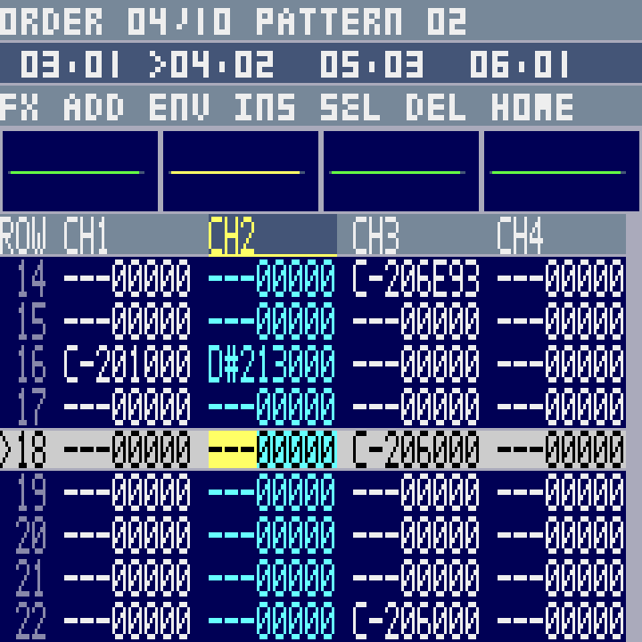

# FM-1 tracker tutorial: make your first MOD

This guide covers the **v32 tracker controls**: the editor installed with
State of the Art (STOA) as the boot song and the separate 29-sound ENV bank.
Follow the numbered lessons to make a new four-channel song. The physical SEL button may be called SCL in LCD prompts and older previews. The control tables
at the end also work as a reference while you edit.

**Your edits live in RAM.** Export your MOD to the PC before switching off or
starting NEW SONG. Restarting the device restores its embedded boot song.
The hardware SAVE button opens the PC file chooser; USB export saves your work.

## Contents

1. [Understand the screen](#1-understand-the-screen)
2. [Start an empty song](#2-start-an-empty-song)
3. [Put sounds into your song](#3-put-sounds-into-your-song)
4. [Audition and write notes](#4-audition-and-write-notes)
5. [Make pattern A: four channels](#5-make-pattern-a-four-channels)
6. [Correct notes and enter effects](#6-correct-notes-and-enter-effects)
7. [Copy a block](#7-copy-a-block)
8. [Arrange A–A–B–fill](#8-arrange-aabfill)
9. [Choose speaker or stereo headphones](#9-choose-speaker-or-stereo-headphones)
10. [Save, reload, and use the file chooser](#10-save-reload-and-use-the-file-chooser)
11. [Use STOA's samples instead](#11-use-stoas-samples-instead)
12. [All controls at a glance](#12-all-controls-at-a-glance)
13. [Troubleshooting](#13-troubleshooting)

## 1. Understand the screen

| Term | Meaning |
| --- | --- |
| Channel / track | One of the four columns. Each channel plays one sample voice at a time. |
| Row | A time position within a pattern, numbered **00–63**. Notes on the same row start together. |
| Pattern | A 64-row page containing all four channels. |
| Order | A position in the song's playlist. Each order refers to a pattern. |
| Sample slot | One of the MOD's 31 sounds. PRESETS chooses the sound for the next piano note. |
| Active Bank | The separate ENV sound library. Copy a bank sound into a MOD sample slot before writing it. |

A song can refer to pattern 00 several times. Editing that pattern changes
every occurrence. Duplicate the pattern to make an independent variation.

The header shows:

| Display | Meaning |
| --- | --- |
| EDIT | Piano keys audition sounds without writing notes. |
| WRITE | Piano keys write notes while playback is stopped. |
| PLAY / PAT | Whole-song playback / current-pattern looping. |
| O00 / P00 | Selected order / the pattern referenced by that order. |
| S01 | Current sample for piano audition and entry. |
| T01 | Entry step: how many rows the cursor advances after a written note. |
| OC−1 | Keyboard octave offset. NEW SONG starts here. |
| SPK / ST | All-channel mono speaker mix / stereo output. |
| * | The song has unsaved changes. |

The highlighted center row is your edit position, or the current playback row.
All four channels remain visible, with one scope above each channel.

Each cell contains **NOTE · SMP · FX · PARAM**. For example:

```text
C-2 01 C20
│   │  └── Effect C, parameter 20 hexadecimal: volume 32
│   └───── Sample slot 01
└───────── Note C in octave 2
```

The compact screen prints this as `C-201C20`. `---` means no new note.
**Rows, orders, patterns, and entry steps use decimal. Samples, effects, and
parameters use hexadecimal:** sample `10` is slot 16; `1F` is slot 31.
Pattern break Dxx is an exception: its digits name a decimal row, so D31 targets row 31.

These are offline layout previews; the song names and notes in your tutorial
will differ:


## 2. Start an empty song

1. Press and release **EDIT** to stop playback and return to the pattern view.
2. Hold **SEQ first**, then press **REC** while keeping SEQ held.
3. Hold both for at least **0.6 seconds**, then release them.
4. Look for **NEW EMPTY SONG**.

You now have order **00**, pattern **00**, and **31 empty sample slots**.
NEW SONG also resets the cursor, quick sample bindings, and clipboard.
The ENV bank remains available.

For this lesson, use the original ENV bank sounds below. To keep STOA's sounds,
use [lesson 11](#11-use-stoas-samples-instead) instead of NEW SONG.

## 3. Put sounds into your song

Import these four sounds. The **bank item** and the **destination song slot**
are separate choices:

| Find this bank sound | Its bank position (decimal) | Copy into song slot (hex) | Purpose |
| --- | ---: | --- | --- |
| TIGHT KICK | 1 | 01 | Channel 1 kick drum |
| DRY SNARE | 3 | 02 | Channel 2 snare |
| CLOSED HAT | 6 | 03 | Channel 3 hi-hat |
| SUB BASS | 17 | 04 | Channel 4 bass |
| EP MAJ7, optional | 20 | 05 | A chord sound for later experiments |

For **each sound**:

1. Press **ENV** to open the Active Bank.
2. Turn **KNOB1** until its name appears. Browsing auditions the sound.
3. Turn **PRESETS** to the destination slot, for example **S02** for DRY SNARE.
4. Press **FX** to copy it into that slot.
5. The bank closes and a **COPIED** notice confirms the import.

Repeat until slots 01–04 contain the four sounds. While the bank is open, piano
keys audition its selected sound at different pitches. **ENV** closes the bank
without importing; **EDIT** closes it and stops the preview.

Copying into an occupied slot replaces its sound for every pattern using that
slot. PRESETS alone selects a slot; it does not import a sound.

## 4. Audition and write notes

### Find the note keys

At the default **OC−1**, the leftmost piano key is **F-1**. The first **C** to
its right is **C-2**: the fifth white key from the left, or the eighth key if
you count both black and white keys.

The first white keys are:

```text
F-1  G-1  A-1  B-1  C-2  D-2  E-2  F-2  G-2 ...
                     ↑
                use this C for the drums
```

**OCT− / OCT+** shift the keyboard by an octave. The tracker accepts notes
C-1 through B-3; keys outside that range do not trigger a note. Stay at OC−1
for this lesson.

### Hear a sound without changing the pattern

1. Press **EDIT**. Confirm the header says **EDIT**.
2. Turn **SELECT** to channel 1.
3. Turn **PRESETS** to **S01**.
4. Press the **C-2 piano key**. You should hear the kick.

Try S02, S03, and S04. Releasing a key lets the sample finish; a looping preview
can continue sounding. Press **EDIT** to stop it.

### Write a note

1. Turn **SELECT** to the destination channel.
2. Turn **KNOB1** to the destination row.
3. Turn **PRESETS** to the sample you want to enter.
4. Turn **KNOB2** to highlight **NOTE**.
5. Turn **KNOB4** to choose the entry step shown as **Txx**.
6. Press **REC** once. Confirm **WRITE**.
7. Press a piano key. It writes the note and current sample into this cell,
   then advances the row by Txx.

Press **REC** again to return to audition. A written note preserves that
cell's existing effect and parameter.

**Select NOTE before setting the entry step.** With PARAM selected, KNOB4 edits
the effect's high hexadecimal digit instead.

Useful steps: **T00** stays on the row, **T01** moves one row, **T04** moves
four, and **T16** moves sixteen. The row wraps from the end back to 00.

## 5. Make pattern A: four channels

We will make a four-bar pattern. At the initial speed of 6, four rows form
one beat and sixteen rows form a bar in this example.

### Channel 1: kick

1. Select **CH1**, sample **S01**, row **00**, field **NOTE**.
2. Set **T16** with KNOB4.
3. Enter **WRITE** with REC if needed.
4. Press **C-2 four times**. The notes land on **00, 16, 32, 48**.
   The cursor returns to 00 after the fourth note.

### Channel 2: snare

1. Turn SELECT to **CH2** and PRESETS to **S02**.
2. Turn KNOB1 to row **08**. Keep NOTE and T16.
3. Press **C-2 four times**: rows **08, 24, 40, 56**.

### Channel 3: hi-hat

1. Select **CH3**, **S03**, row **00**.
2. With NOTE highlighted, set **T04**.
3. Press **C-2 sixteen times**: rows **00, 04, 08, …, 60**.

### Channel 4: bass

1. Select **CH4**, **S04**, row **00**, field NOTE.
2. Set **T16**.
3. Play these four keys in order: **C-2, C-2, A#1, G-1**.
   A#1 is the black key immediately left of B-1; G-1 is the second white key
   from the left at OC−1.

Your pattern should contain:

| Row(s), decimal | CH1, sample 01 | CH2, sample 02 | CH3, sample 03 | CH4, sample 04 |
| --- | --- | --- | --- | --- |
| 00 | C-2 | — | C-2 | C-2 |
| 08 | — | C-2 | C-2 | — |
| 16 | C-2 | — | C-2 | C-2 |
| 24 | — | C-2 | C-2 | — |
| 32 | C-2 | — | C-2 | A#1 |
| 40 | — | C-2 | C-2 | — |
| 48 | C-2 | — | C-2 | G-1 |
| 56 | — | C-2 | C-2 | — |
| 04, 12, 20, 28, 36, 44, 52, 60 | — | — | C-2 | — |

### Listen

Press **GLO** to loop this pattern from row 00. The header shows **PAT**.
Press GLO again to stop, or press EDIT to stop and return to audition.

**PLAY/STOP** plays the song from row 00 of the selected order instead. Starting
or stopping playback clears WRITE, so press REC again before entering more
notes. Playback follows the highlighted row; piano keys can audition sounds
during playback, but note writing and pattern changes require stopping.

## 6. Correct notes and enter effects

Stop playback first. These explicit edits work in either EDIT or WRITE.
REC only determines whether **piano keys** write notes.

### Correct a cell

Use **SELECT** for the channel and **KNOB1** for the row. Then use KNOB2:

| Highlight | KNOB3 does this | KNOB4 does this |
| --- | --- | --- |
| NOTE | Transposes an existing note, one semitone per click | Changes entry step |
| SMP | Changes this cell's sample number | Changes entry step |
| FX | Changes effect 0–F | Changes entry step |
| PARAM | Changes the low hex digit | Changes the high hex digit |

- **SEL** clears only the highlighted field.
- **LFO** clears the whole cell: note, sample, effect, and parameter.
- To overwrite a note, choose its sample with PRESETS, enter WRITE, and press
  the desired piano key. Set T00 first if you want the cursor to stay there.
- KNOB3 cannot turn a blank NOTE into a note; use a piano key.
- PRESETS chooses the sound for the **next** note. To change the sample of an
  **existing** note, select its SMP field and turn KNOB3.

### Set the tempo to 160 BPM

The empty song starts at 125 BPM, speed 6. Put **FA0** on row 00 of CH1:

1. Select **CH1**, row **00**.
2. Turn **KNOB2** to **FX**; turn **KNOB3** until the effect is **F**.
3. Turn KNOB2 to **PARAM**.
4. Turn **KNOB4** until the first parameter digit is **A**.
5. Turn **KNOB3** until the second digit is **0**.

The kick cell now reads `C-2 01 FA0`. A0 hexadecimal is 160 decimal.
Press GLO to hear it at 160 BPM.

Some useful effects:

| Effect + parameter | Meaning | Example |
| --- | --- | --- |
| F01–F20 | Set ticks per row (speed), 1–32 in this firmware | F06 = speed 6 |
| F21–FFF | Set BPM, 33–255 in this firmware | FA0 = 160 BPM |
| C00–C40 | Set that channel's volume, 0–64 | C20 = volume 32 |
| Axy | Volume slide | A01 slides down; A10 slides up |
| Dxx | End this pattern and continue at the next order's decimal row xx | D00 on row 31 makes a shorter section |

Use KNOB4 for PARAM's left digit and KNOB3 for its right digit. For example,
**C20** means FX=C, high digit=2, low digit=0. In pattern-loop playback, a Dxx
break loops back into the selected pattern instead of advancing through orders.

## 7. Copy a block

Example: copy CH1–CH3, rows 00–15, onto rows 16–31.

1. Stop playback and return to the normal pattern view.
2. Select **CH1**, row **00**.
3. Hold **SEQ**. While holding it, move KNOB1 to **15** and SELECT to **CH3**.
   The rectangle becomes shaded.
4. Release SEQ. The selection remains.
5. Hold **SEQ**, press **SEL**, then release both to copy.
6. Without holding SEQ, navigate to **CH1**, row **16**.
7. Hold **SEQ**, press **LFO**, then release both to paste.
8. Tap **SEQ** alone to clear the shading.

Paste overwrites every field in the destination rectangle, including blank
cells. It clips at row 63 and channel 4. The clipboard remains available after
clearing the selection and can be pasted into another pattern. There is no undo.

## 8. Arrange A–A–B–fill

Our first pattern is **00**, which we call **A** here. The letters are tutorial
labels; the FM-1 displays pattern numbers.

**HOME** opens the compact order arranger. In this context, button meanings
change. **ALGORITHM** selects an order; **KNOB3** selects which existing pattern
that order plays.



### Repeat A, then create an independent B

1. Stop playback with **EDIT**. Turn ALGORITHM to order **00**.
2. Press **HOME** to open the arranger.
3. Press **FX** once. It appends order **01 → pattern 00** and selects it.
   The song is now **A–A**.
4. Press **FX** again. It appends **02 → pattern 00** and selects it.
5. Tap **SEQ**. It copies pattern 00 into a new **pattern 01**, assigning it
   to the selected order 02. The song is now **A–A–B**.
6. Press **HOME** to return to pattern editing.

You are editing P01 now. To make B different:

1. Select CH4, row 32, field NOTE.
2. Turn KNOB3 until **A#1 becomes D-2**: four clicks to the right.
3. Select CH1, sample S01, row 44; choose NOTE and T00.
4. Press REC for WRITE, then press C-2 to add an extra kick.
5. Press REC to return to audition.

Pattern 00 remains A. Pattern 01 is your independent B variation.

### Add a fill

1. Press **HOME**, then **FX**. This appends order **03 → pattern 01**.
2. Tap **SEQ** to duplicate pattern 01 into new **pattern 02** at order 03.
3. Press **HOME** to return to pattern editing.
4. Select **CH2**, **S02**, row **56**, field NOTE.
5. Set **T02**. Press REC for WRITE and press C-2 four times.
   Snare hits now occur on **56, 58, 60, 62**.
6. Press EDIT when finished.

The order list is now:

| Order | Pattern | Section |
| --- | --- | --- |
| 00 | 00 | A |
| 01 | 00 | A again, sharing the same pattern data |
| 02 | 01 | B variation |
| 03 | 02 | Fill |

Turn **ALGORITHM** to order **00**, then press **PLAY/STOP**. The player follows
00 → 01 → 02 → 03 and loops the song at the end. Stop with PLAY/STOP or EDIT.
Use GLO when you want to hear only the currently selected pattern repeatedly.

### Add a completely blank pattern

To add a new section at the end, open HOME, press **FX to append an order**,
then **ARP to create a blank pattern for that order**, then HOME to edit it.

**ARP and SEQ assign a new pattern to the selected order. They do not append
an order themselves.** Appending first keeps the earlier section in the song.

### Every arranger operation

All changes require stopped playback:

| Control while HOME arranger is open | Action |
| --- | --- |
| ALGORITHM | Select an order position |
| KNOB3 | Change that order's reference to an existing pattern |
| FX | Append the selected pattern reference to the end; select the new order |
| ENV | Insert the reference before the selected order; select the inserted order |
| SEL | Delete the selected order; at least one order remains |
| LFO | Duplicate the order reference immediately after it; select the duplicate |
| ARP | Create a new blank pattern and assign it to the selected order |
| SEQ, tap and release | Duplicate the current pattern's data into a new pattern and assign it to the selected order |
| HOME | Close the arranger and return to pattern fields |

**LFO duplicates a playlist entry. SEQ duplicates the actual pattern data.**
When reusing an existing pattern, append with FX and use KNOB3 to choose its
number. There are up to 128 orders and 128 patterns, subject to the 256 KiB song
buffer shared with samples. A full-buffer notice means the operation failed.

## 9. Choose speaker or stereo headphones

1. Hold **SAVE**.
2. Turn **KNOB3 right** for **ST**, or **left** for **SPK**.
3. Release SAVE. Confirm ST or SPK in the top line.

- **SPK:** all four channels are mixed into mono, so the built-in speaker
  includes every part. Audio OUT receives that mono mix too.
- **ST:** Audio OUT is stereo: CH1/CH4 left, CH2/CH3 right. Use this for stereo
  headphones. The mono speaker may reproduce only part of this stereo mix.

Turning KNOB3 without holding SAVE edits the selected field. Holding SAVE
during the turn also prevents the file chooser from opening when you release it.
Use the physical **MASTER** control for listening volume.

## 10. Save, reload, and use the file chooser

### Save your new MOD to the PC

Connect USB. In a PowerShell terminal at `F:\dev\fm1`, run:

```powershell
C:\Python311\python.exe firmware/protracker/client.py list
New-Item -ItemType Directory -Force private-library/MOD/edits | Out-Null
C:\Python311\python.exe firmware/protracker/client.py save --port COM6 --file private-library/MOD/edits/my-first.mod
```

Use the COM port shown by `list`; **COM6** is the previously observed port and
can change. The destination directory must exist. The client stops playback,
exports the complete MOD with its samples, and verifies the transfer.
It refuses to overwrite an existing PC file: use `my-first-02.mod` next time.

The MOD contains sample audio, patterns, orders, and effects. Quick bindings,
cursor position, and the separate ENV bank are not saved in it. This command
saves to the **PC**, not to the FM-1's embedded flash song.

### Reload your saved song

```powershell
C:\Python311\python.exe firmware/protracker/client.py upload --port COM6 --file private-library/MOD/edits/my-first.mod
```

Upload replaces the RAM song. If the FM-1 has unsaved edits, first save them;
the client normally refuses to discard them. After loading, use PLAY/STOP or GLO
on the FM-1.

### Choose a PC file from the FM-1 screen

Run this PC service to include the standard library and your saved songs:

```powershell
C:\Python311\python.exe firmware/protracker/library_server.py serve --port COM6 --library firmware/protracker/samples --library private-library/MOD --library private-library/MOD/edits
```

Then, on the FM-1:

1. Press and release **SAVE** to open the file chooser.
2. Turn **SELECT or KNOB1** to choose a MOD.
3. Press **PLAY/STOP** to request and load it. Press PLAY/STOP again after the
   load to play the song.
4. **SAVE or HOME** closes the chooser. **EDIT** returns to pattern audition.

The chooser needs the PC service running. Directories are not scanned
recursively, which is why `edits` is included separately above. The catalog
supports up to 32 compatible MODs, each at most 256 KiB.
On selecting another file, the service exports a dirty RAM song to
`private-library/MOD/edits` before replacing it.

Press **Ctrl+C** in the service terminal before using `client.py save` or
`upload`; only one program can own the USB serial port at a time. Restart the
service to refresh its catalog after adding files.

## 11. Use STOA's samples instead

The v32 embedded STOA MOD has **30 nonempty sample slots**. They are part of
that song and selectable with PRESETS; they are separate from the 29 original
sounds in ENV. **NEW SONG empties the song slots, including STOA's samples.**

To compose a new pattern while retaining STOA's sounds:

1. Start with STOA loaded. Press **EDIT** to stop.
2. Press **HOME**, then **FX** to append a new order at the end.
3. Press **ARP** to assign a new blank pattern to that new order.
4. Press **HOME** to return to the pattern view.
5. Choose a channel with SELECT, browse STOA's sounds with PRESETS, and audition
   with the piano keys.
6. Select NOTE and an entry step, press REC for WRITE, and enter your notes.
7. Use **GLO** to loop your new pattern. PLAY follows the selected order into
   the rest of the song.
8. Export the edited MOD to a new PC filename.

This adds your section to the STOA song. To turn it into a song containing
only your sections, use HOME and SEL to remove unwanted **orders**. Deleting an
order does not remove the sample bank or the underlying pattern data.

STOA already fills much of the RAM song buffer, so importing extra bank sounds
or duplicating many patterns can reach its capacity. For the small worked
example, the empty-song route with four ENV imports gives you more room.

## 12. All controls at a glance

### Seven encoders in the normal pattern view

| Encoder | Operation |
| --- | --- |
| SELECT | Select channel 1–4; wraps; one detent moves one channel |
| ALGORITHM | Select order while stopped; wraps |
| KNOB1 | Select row 00–63 while stopped; wraps; one detent moves one row |
| KNOB2 | Select NOTE → SMP → FX → PARAM; wraps |
| KNOB3 | Edit the selected field; PARAM's low digit; stopped only |
| KNOB4 | Cycle entry step 0, 1, 2, 3, 4, 6, 8, 16; on PARAM, edit its high digit instead; stopped only |
| PRESETS | Select current song sample 01–1F; stops at the ends |

Context overrides: ENV bank uses KNOB1 to browse and PRESETS for the import
destination; HOME arranger uses KNOB3 for the pattern reference; USB chooser
uses SELECT/KNOB1 for files. Other encoders can retain their normal function
in the bank or arranger, so use only the controls listed for that lesson.

### Buttons in the normal pattern view

| Button | Operation |
| --- | --- |
| OCT− / OCT+ | Lower / raise keyboard octave offset, bounded −2 to +1 |
| FX | Move to the next field |
| SEL | Clear highlighted field while stopped |
| ENV | Open / close Active Bank |
| LFO | Clear entire selected cell while stopped |
| EDIT | On release, stop playback/preview and return to audition; retain cursor position |
| GLO | Start selected-pattern loop at row 00; if playback is running, stop it |
| HOME | Open / close order arranger while stopped |
| SAVE | On release, open / close USB PC file chooser |
| ARP | No standalone action in this view; creates a blank pattern in HOME |
| SEQ | On release, clear block selection; also a modifier for blocks and NEW SONG |
| PLAY/STOP | Start song at row 00 of selected order; if running, stop at the last triggered row |
| REC | Toggle WRITE while stopped |
| Piano keys | Audition selected sample; in stopped WRITE, also write note/sample and advance |

### Chords and quick samples

For a chord, hold the modifier first, then operate the other control.

| Chord | Operation |
| --- | --- |
| SEQ + REC, hold 0.6 seconds | NEW SONG with empty sample slots |
| SEQ + KNOB1 / SELECT | Extend a rectangular row/channel selection |
| SEQ + SEL | Copy selected rectangle |
| SEQ + LFO | Paste clipboard at cursor |
| SAVE + KNOB3 right / left | ST stereo / SPK mono |
| EDIT + quick button, brief press | Select its bound sample |
| EDIT + quick button, hold 0.6 seconds | Bind the sample selected with PRESETS when the chord began |

| Quick slot | Button held with EDIT |
| --- | --- |
| Q1 | OCT− |
| Q2 | OCT+ |
| Q3 | FX |
| Q4 | SEL |
| Q5 | ENV |
| Q6 | LFO |
| Q7 | ARP |
| Q8 | SEQ |

Example: choose **S02** with PRESETS; hold EDIT, then hold **OCT+** for 0.6
seconds. Release OCT+ and EDIT. Q2 now selects the snare. Later, hold EDIT and
briefly press OCT+ to select it, then play a piano key to audition or write it.
The chord preserves WRITE; it does not shift octave or run the button's normal
action. Bindings refer to song slots and reset on NEW SONG or upload.

### The ENV bank's available sounds

| Bank positions, decimal | Sounds, in order |
| --- | --- |
| 1–8 | TIGHT KICK, DEEP KICK, DRY SNARE, CRUNCH SNARE, CLAP, CLOSED HAT, OPEN HAT, METAL RIDE |
| 9–16 | RIM CLICK, LOW TOM, HIGH TOM, SHAKER, CHOP KICK HAT, CHOP SNARE GHOST, CHOP RIM SHUFFLE, CHOP TOM TURN |
| 17–24 | SUB BASS, SAW BASS, DIRTY REESE, EP MAJ7, EP MIN7, RAVE CHORD, ORGAN PLUCK, ORCHESTRA HIT |
| 25–29 | REVERSE SWEEP, SCRATCH ZIP, COME ON!, HEY!, YEAH! |

## 13. Troubleshooting

| What happens | What to check / do |
| --- | --- |
| New song is silent | Its sample slots are empty. ENV → KNOB1 chooses a sound → PRESETS chooses a destination → FX imports it. |
| Piano makes sound but writes nothing | Stop playback, close the bank, press REC, and confirm WRITE. |
| Piano overwrites a note unexpectedly | Press REC for EDIT, or press EDIT to stop and return to audition. |
| Cursor jumps many rows after a note | Select NOTE, then set KNOB4 to the desired Txx. |
| KNOB4 changes an effect instead of scrolling or step | PARAM is selected. KNOB1 selects rows; select NOTE before setting step. |
| KNOB3 does not create a note | It transposes existing notes. Enter a blank cell's note with the piano in WRITE. |
| Changing PRESETS leaves the existing note's sound unchanged | Select the cell's SMP field and use KNOB3, or overwrite it with a piano note in WRITE. |
| Two sections change together | Their orders reference the same pattern. Append an order, then SEQ in HOME to make an independent copy. |
| ARP replaced a section instead of extending the song | ARP assigns a blank pattern to the selected order. Append with FX first. |
| Playback starts from the beginning of the selected pattern | PLAY and GLO start at row 00, regardless of the edit cursor row. |
| Some parts are missing from the built-in speaker | Hold SAVE and turn KNOB3 left for SPK. Use ST for stereo Audio OUT. |
| SAVE does not save my edits | SAVE opens the chooser. Use the PC `client.py save` command to export. |
| File chooser has no usable PC library | Start `library_server.py serve` with the correct COM port and directories. |
| PC reports the serial port is busy | Stop the library server with Ctrl+C before running the client. |
| BANK COPY FULL / ORDER/PATTERN FULL | The RAM song buffer or structure limit is full; the requested change did not complete. |

This guide was checked against the v32 editor source and the PC tool arguments.
It describes the implemented controls; it is not a new physical acceptance test.
For the compact reference and implementation details, see [README.md](README.md).
